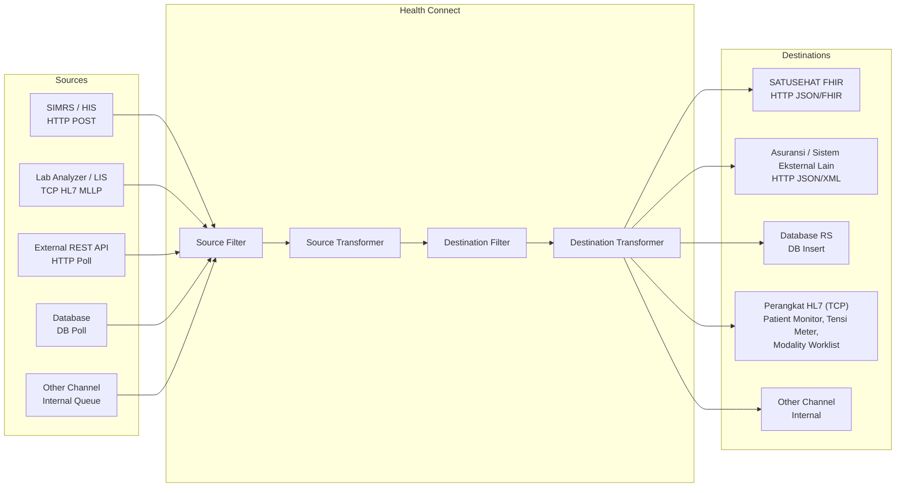

# Health Connect Middleware

Integration engine untuk menerima data dari berbagai sistem, memfilter/mentransformasi, lalu meneruskannya ke satu atau banyak destinasi.

- **Backend**: Go (Gin) + SQLite (default) / MySQL / PostgreSQL
- **Frontend**: React + Vite (di-embed ke binary Go saat build)
- **Fitur**: multi-source & multi-destinasi per channel, source/destination filter, transformer JavaScript, variabel scoped (otomatis di-mask untuk key sensitif), test connection, global environments, manajemen user.

## Alur Data




## Struktur Proyek

```
middleware/
├── backend-go/      # Backend Go (main.go, engine.go, queue.go, db.go, types.go)
│   ├── config.json  # Konfigurasi port (default 3001)
│   └── dist/        # Output build frontend (di-embed via go:embed)
├── frontend/        # React + Vite (dev server port 3000)
├── Installer/       # Output installer Inno Setup
└── health-connect-installer.iss
```

## Prasyarat

| Tool | Versi | Keterangan |
|------|-------|------------|
| [Go](https://go.dev/dl/) | sesuai `backend-go/go.mod` | Backend |
| [Node.js](https://nodejs.org/) | 18+ | Frontend |
| [Inno Setup](https://jrsoftware.org/isinfo.php) | 6+ | Opsional, untuk installer |
| [go-winres / rsrc](https://github.com/tc-hib/go-winres) | - | Opsional, untuk embed icon exe |

## Menjalankan Mode Development

Jalankan backend dan frontend di dua terminal terpisah.

**1. Backend** (port `3001`)

```powershell
cd D:\middleware\backend-go
go run .
```

> `go run` membutuhkan folder `backend-go/dist` (karena `//go:embed dist/*`). Jika belum ada, jalankan sekali build frontend (lihat bagian *Compile Frontend*).

**2. Frontend** (port `3000`)

```powershell
cd D:\middleware\frontend
npm install      # hanya pertama kali
npm run dev
```

Buka http://localhost:3000. Pada mode dev, frontend memanggil API di `http://localhost:3001/api`.

**Login default**: `admin` / `admin` (segera ganti password di menu **Users**).

## Konfigurasi

### Port aplikasi — `backend-go/config.json`

```json
{
  "port": 3001
}
```

File dibuat otomatis jika belum ada.

### Database — environment variable

| Variable | Keterangan | Default |
|----------|------------|---------|
| `DB_TYPE` | `sqlite`, `mysql`, atau `postgres` | `sqlite` |
| `DB_HOST` | Host:port (mysql/postgres) | - |
| `DB_USER` | Username | - |
| `DB_PASS` | Password | - |
| `DB_NAME` | Nama database / file sqlite | `middleware` / `middleware.db` |

Contoh PostgreSQL:

```powershell
$env:DB_TYPE="postgres"; $env:DB_HOST="localhost:5432"; $env:DB_USER="postgres"; $env:DB_PASS="secret"
go run .
```

## Compile Frontend

Output langsung ditulis ke `backend-go/dist` (lihat `vite.config.js`).

```powershell
cd D:\middleware\frontend
npm install
npm run build
```

## Compile Backend

Pastikan frontend sudah di-build terlebih dahulu agar `dist/` ter-embed.

```powershell
cd D:\middleware\backend-go
go build -o health-connect.exe .
```

Jalankan: `.\health-connect.exe`, lalu buka http://localhost:3001 (frontend sudah terbundel dalam binary).

## Compile Menjadi EXE (Windows x64, dengan icon)

```powershell
cd D:\middleware\backend-go
# opsional: generate ulang resource icon (rsrc.syso) dari app.ico
rsrc -ico app.ico -o rsrc.syso

$env:GOOS="windows"; $env:GOARCH="amd64"
go build -ldflags "-s -w" -o health-connect-x64.exe .
```

Hasil: `backend-go\health-connect-x64.exe` (single binary, berisi frontend + backend). `config.json` dan `middleware.db` dibuat di folder tempat exe dijalankan.

## Compile Menjadi Installer

Installer dibuat dengan **Inno Setup** dari [health-connect-installer.iss](health-connect-installer.iss).

1. Build frontend, lalu build `health-connect-x64.exe` (langkah di atas).
2. Compile installer:

```powershell
& "C:\Program Files (x86)\Inno Setup 6\ISCC.exe" D:\middleware\health-connect-installer.iss
```

   Atau buka file `.iss` di Inno Setup Compiler lalu tekan **Compile** (`Ctrl+F9`).
3. Hasil: `Installer\Setup Health Connect.exe` — terinstal ke `%LOCALAPPDATA%\Health Connect` dan menambahkan shortcut Start Menu / Desktop (opsional).

## Ringkasan Cara Pakai

1. Login → menu **Channels** → **New Channel**.
2. Tab **Source**: pilih protokol (HTTP POST, HTTP Poll, TCP, Database Poll, Internal), atur filter & transformer.
3. Tab **Destinations**: tambah satu/lebih destinasi, atur filter routing & transformer masing-masing.
4. Gunakan **Variables** untuk menyimpan kredensial, lalu referensikan dengan `{{NAMA_VARIABEL}}` (mis. `PWD={{DB_PASSWORD}}` pada DSN). Key yang mengandung `key/pass/secret/token/pwd/dsn` otomatis disembunyikan.
5. Klik **Test Connection** untuk verifikasi, lalu **Save Channel**.

## Troubleshooting

- **`pattern dist/*: no matching files found`** → jalankan `npm run build` di folder `frontend` terlebih dahulu.
- **Port bentrok** → ubah `port` di `backend-go/config.json` (dan sesuaikan `API_BASE` di `frontend/src/App.jsx` untuk mode dev).
- **Warning SonarLint tidak hilang** → buka file terkait dan simpan ulang agar IDE menganalisis ulang.